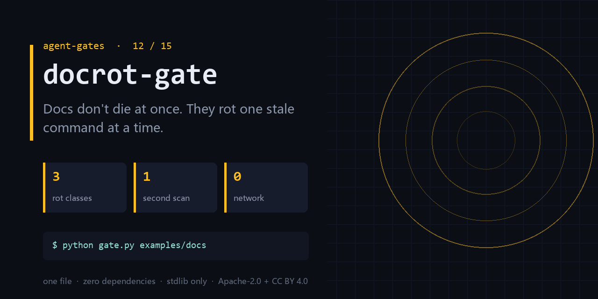

<div align="center">

</div>

<h1 align="center">docrot-gate</h1>

<p align="center"><b>Docs don't die at once. They rot one stale command at a time.</b><br><sub>one file · zero dependencies · stdlib only</sub></p>

<p align="center"><a href="https://github.com/chenhz01/docrot-gate/actions/workflows/gate.yml"></a>   </p>

---

## The failure this catches

- The README command worked three years ago; a new hire runs it and gets an error.
- Docs reference files that were renamed; the links 404 and nobody goes back to fix them.
- The version is hardcoded in three places and the real version is a fourth.

One command, on a file you already have:

```bash
python gate.py examples/docs
```

<details>
<summary><b>Real output</b> — produced by the bundled <code>examples/</code>, not a mock-up</summary>

```text
docrot-gate: root=examples/docs
docs: 2, refs checked: 4, broken: 2, external skipped: 0
BROKEN README.md:3 [code-path] ./scripts/old_deploy.sh
BROKEN README.md:5 [link] missing.md
```

</details>

## What it does

- Checks relative links, referenced make targets, and version strings against the repo.
- JSON output for dashboards, plain text for humans.
- Runs in a second on a normal docs tree — make it a pre-commit hook.

## What it does **not** do

- It does not execute commands in docs. It checks that targets exist.
- It cannot detect prose that is logically wrong but syntactically fine.
- External URL liveness is out of scope (network flakiness is not a finding).

Being explicit here is cheaper than a wrong expectation later.

## Exit codes

`0` = no stale reference. `1` = broken reference found. `2` = bad input.

## Install

```bash
git clone https://github.com/chenhz01/docrot-gate
cd docrot-gate
python gate.py --help
```

Python 3.9+. Nothing to `pip install` — stdlib only.

## Use it in CI

```yaml
- name: docrot-gate
  run: python gate.py examples/docs
```

## Use it as a GitHub Action

`action.yml` is included, so you can call this repo directly as a composite action.

```yaml
# .github/workflows/gates.yml
- uses: actions/checkout@v4

- uses: chenhz01/docrot-gate@v0.1.2
  with:
    # IMPORTANT: this path is inside YOUR repository.
    # The examples/ in this repo are NOT in your workspace — pass your own files.
    args: "path/to/docs"
```

Pin the tag (`@v0.1.2`) rather than `@main` — `main` moves.
Check [Releases](https://github.com/chenhz01/docrot-gate/releases) for the newest tag; `v0.1.0` predates the
fix that makes a mistyped path fail instead of silently passing.

If you omit `args`, the action only prints help and exits 0. It raises a warning
annotation — quoting this gate's own correct usage — so a green check is never
mistaken for "it inspected my files".


## 中文速览

**文档腐烂门** — 文档不是一次性死掉的，它一个命令一个命令地烂掉。

- README 里那条命令三年前能用，新人照着敲，报错。
- 文档引用的文件早就改名了，链接 404，没人回头修。
- 版本号写死在三个地方，实际版本是第四个。

一行命令：`python gate.py examples/docs`

边界：It does not execute commands in docs. It checks that targets exist.

## The gates

| # | gate | what it stops |
|---|---|---|
| 02 | **[loop-gate](https://github.com/chenhz01/loop-gate)** | Find where your agent looped, before it burns another run |
| 03 | **[permission-gate](https://github.com/chenhz01/permission-gate)** | Score how much more your agent can do than it should |
| 04 | **[context-gate](https://github.com/chenhz01/context-gate)** | Measure what truncation deletes, before the model starts guessing |
| 05 | **[instruction-gate](https://github.com/chenhz01/instruction-gate)** | Two of your instructions contradict each other. This finds them |
| 06 | **[output-gate](https://github.com/chenhz01/output-gate)** | Before AI-written text ships, run the four checks it always fails |
| 07 | **[memory-expiry-gate](https://github.com/chenhz01/memory-expiry-gate)** | Give every memory a TTL, then prove the expiry semantics actually hold |
| 08 | **[drift-gate](https://github.com/chenhz01/drift-gate)** | When embeddings drift, retrieval quietly rots. Fingerprint it |
| 09 | **[price-gate](https://github.com/chenhz01/price-gate)** | Your cost model is only as good as the price table under it |
| 10 | **[complexity-ceiling](https://github.com/chenhz01/complexity-ceiling)** | Per-file complexity budgets that fail the build instead of the reviewer |
| 11 | **[deadcode-gate](https://github.com/chenhz01/deadcode-gate)** | Quantify how much of the repo is dead, instead of guessing |
| 12 | **docrot-gate** ← you are here | Docs don't die at once. They rot one stale command at a time |
| 13 | **[leak-gate](https://github.com/chenhz01/leak-gate)** | Scan for internal detail before the doc leaves the building |
| 14 | **[backup-gate](https://github.com/chenhz01/backup-gate)** | A backup you have never verified is a rumor |
| 15 | **[trail-gate](https://github.com/chenhz01/trail-gate)** | Hash-chained agent audit trail — and it verifies its own chain |

## License

- Code: **Apache-2.0** — see [LICENSE](LICENSE)
- Docs and example data: **CC BY 4.0** — see [LICENSE-SPEC](LICENSE-SPEC)

Attribution required when you redistribute the documentation; code can be used commercially
without a separate agreement. See [NOTICE](NOTICE).
